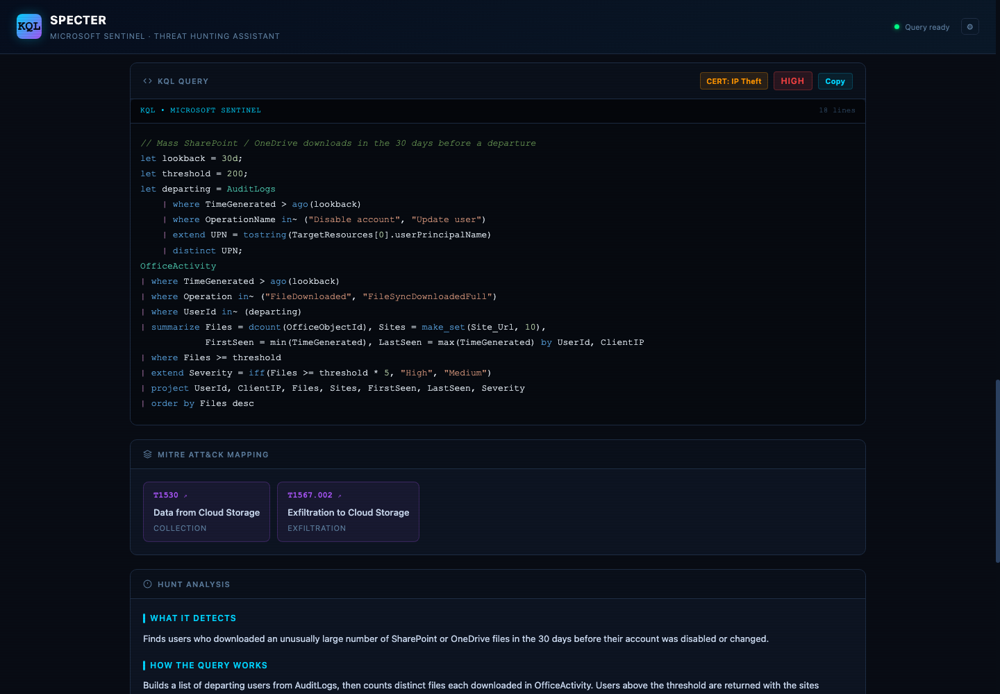
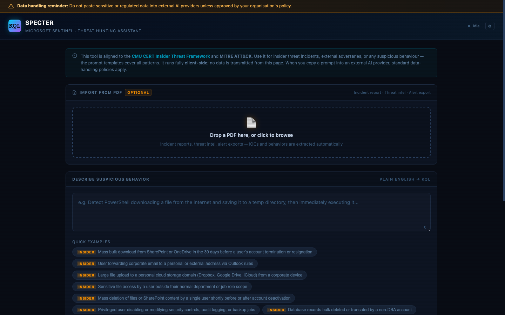
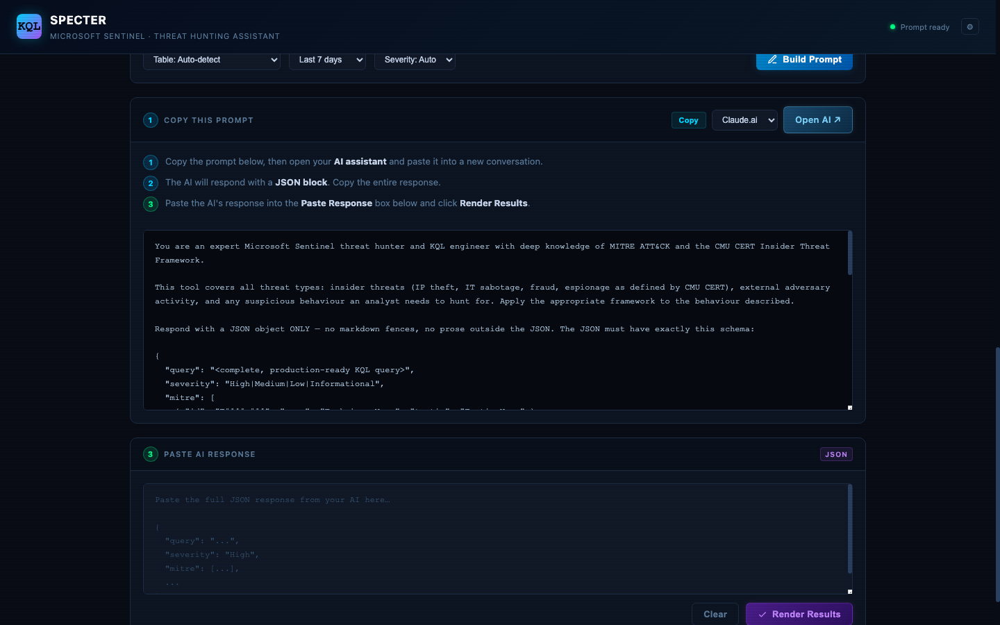

# SPECTER — Sentinel Threat Hunting Query Generator


<p align="center"></p>

---

## Overview

SPECTER is a zero-dependency, fully client-side web application that helps SOC analysts and threat hunters generate production-ready KQL (Kusto Query Language) queries for Microsoft Sentinel without needing to know KQL syntax. Describe suspicious behavior in plain English, and SPECTER generates the query, MITRE ATT&CK mapping, false positive guidance, and response actions — directly in your browser.

Aligned to two industry-standard frameworks:
- **MITRE ATT&CK Enterprise** — external adversary tactics, techniques, and procedures
- **CMU CERT Insider Threat Framework** — IP theft, IT sabotage, fraud, and espionage categories

Everything runs in the browser. No server, no backend. When an API key is configured, queries are generated in one click with no copy-paste required.

---

## Screenshots

<p align="center">&nbsp;</p>

<p align="center"><sub>Describe behavior or import a PDF · Structured prompt ready for any AI assistant</sub></p>

---

## What It Does

1. **Plain English to KQL** — describe suspicious behavior, get a production-ready query
2. **One-click AI generation** — configure a Groq, Anthropic, or Gemini API key and generate queries instantly with no copy-paste loop
3. **Manual fallback** — build a structured prompt and paste into any AI (Claude, ChatGPT, Gemini, Copilot, Perplexity) for air-gapped or restricted environments
4. **PDF import** — drag-and-drop incident reports; IOCs and behaviors extracted automatically, hunt description auto-populated
5. **25+ built-in examples** — categorized as Insider, Exfil, and General threat hunting scenarios
6. **MITRE ATT&CK mapping** — every query tagged with technique IDs and tactics, each card links directly to attack.mitre.org
7. **CMU CERT categorization** — insider threat queries tagged as IP Theft, IT Sabotage, Fraud, or Espionage
8. **KQL syntax highlighting** — color-coded output for keywords, functions, operators, strings, table names
9. **Table selector** — target specific Sentinel or MDE tables, or let the AI choose
10. **Time range selector** — 1d, 7d, 14d, 30d, 90d sliding windows
11. **Severity selector** — High, Medium, Low, Informational, or auto
12. **Hunt Analysis** — what the query detects, how the logic works, why it indicates threat activity
13. **False positives panel** — AI-generated list of expected benign triggers per query
14. **Response actions panel** — concrete next steps after a hunt fires
15. **Hunting tips panel** — tuning and follow-on investigation guidance
16. **Query history** — last 10 generated queries auto-saved to localStorage, click any entry to restore instantly
17. **Saved query library** — permanently star/save queries with custom labels (e.g. "IR-2024-042 PowerShell Exfil"), export entire library as `.md`
18. **Export to Markdown** — download a complete hunting package as `.md`
19. **Export to JSON** — download the full result as structured `.json` for scripting or SIEM ingestion
20. **Sentinel ARM template** — export as an Azure Resource Manager template deployable directly into Sentinel as a Scheduled Analytics Rule
21. **Zero dependencies** — single HTML file, runs offline, air-gappable

---

## AI Provider Support

| Provider | Cost | Key prefix | Get a key |
|----------|------|-----------|-----------|
| **Groq** | Free (14,400 req/day) | `gsk_...` | console.groq.com |
| **Anthropic** | ~$0.01–0.08/query | `sk-ant-...` | console.anthropic.com |
| **Gemini** | Paid (billing required) | `AIza...` | aistudio.google.com |

API keys are stored in your browser's localStorage only — never transmitted anywhere except to the chosen AI provider.

---

## Stack

| Layer | Technology |
|-------|-----------|
| Frontend | Vanilla JavaScript, inline CSS |
| AI | Groq (Llama 3.3 70B), Anthropic Claude Haiku, Google Gemini |
| Frameworks | MITRE ATT&CK, CMU CERT Insider Threat |
| Dependencies | None |

---

## Supported Sentinel / MDE Tables

| Table | Source | Use Case |
|-------|--------|----------|
| `SecurityEvent` | Windows Security log | Process execution, logon events |
| `DeviceProcessEvents` | MDE | Endpoint process behavior |
| `DeviceNetworkEvents` | MDE | Network connections from endpoints |
| `DeviceFileEvents` | MDE | File creation, modification, deletion |
| `DeviceRegistryEvents` | MDE | Registry key changes |
| `DeviceEvents` | MDE | USB, clipboard, other device events |
| `SigninLogs` | Azure AD | Authentication events |
| `AuditLogs` | Azure AD | Directory and resource changes |
| `OfficeActivity` | Microsoft 365 | SharePoint, OneDrive, Exchange |
| `CloudAppEvents` | Defender for Cloud Apps | SaaS app activity |
| `AzureActivity` | Azure Control Plane | Resource management actions |
| `Syslog` | Linux | Linux system events |
| `CommonSecurityLog` | CEF sources | Firewall, proxy, network appliances |

---

## Built-In Example Scenarios

### Insider Threat (CMU CERT Framework)

| Category | Scenario |
|----------|---------|
| IP Theft | Mass bulk download from SharePoint/OneDrive before termination |
| IP Theft | Email forwarding to personal address via Outlook rules |
| IP Theft | Large file upload to personal cloud storage |
| IP Theft | Sensitive file access outside user's department scope |
| IT Sabotage | Mass file/SharePoint deletion before or after account deactivation |
| IT Sabotage | Privileged user disabling security controls or audit logging |
| IT Sabotage | Database bulk delete/truncate by non-DBA account |
| Fraud | After-hours access to HR/payroll/financial systems |
| Fraud | Impossible travel — two logins from geographically impossible locations |
| Fraud | User accessing a terminated colleague's account |

### Exfiltration / Staging

| Scenario |
|---------|
| USB storage connected followed by large file copy |
| Data staged in temp folder then archived with 7-Zip/WinRAR |
| DNS exfiltration via unusually long subdomains |
| Sensitive keyword search across SharePoint/OneDrive |

### General Threat Hunting

| Scenario |
|---------|
| PowerShell downloading and executing a file from the internet |
| Brute force against Azure AD accounts |
| Lateral movement via PsExec or WMI |
| Ransomware deleting shadow copies (vssadmin) |
| Kerberoasting — SPN enumeration and TGS ticket requests |
| LSASS memory dumping via procdump or Task Manager |
| Pass-the-hash / pass-the-ticket authentication anomalies |
| Office macro spawning suspicious child processes |

---

## Usage

### Prerequisites

None. Open `index.html` in any modern browser.

### Setup (optional — for one-click generation)

1. Get a free API key from [console.groq.com](https://console.groq.com) or a paid key from [console.anthropic.com](https://console.anthropic.com)
2. Click the **⚙** gear icon in the top-right header
3. Paste your key — the provider is auto-detected from the key prefix
4. Click **Save key**

The **Generate with AI** button will appear next to Build Prompt.

### Workflow (with API key)

1. (Optional) Drop a PDF incident report — IOCs and behaviors extracted automatically
2. Describe the behavior or click a quick example pill
3. Set table, time range, and severity
4. Click **Generate with AI** — KQL and analysis appear instantly
5. Click MITRE technique cards to open attack.mitre.org
6. Star the query to save it permanently, rename it by incident (e.g. "IR-2024-042")
7. Export as `.md`, `.json`, or Sentinel ARM template

### Workflow (manual / air-gapped)

1. Describe the behavior and click **Build Prompt**
2. Copy the prompt, open your AI of choice, paste and get the JSON response
3. Paste the JSON response into the **Paste AI Response** box
4. Click **Render Results**

---

## Export Options

| Format | Use case |
|--------|---------|
| **Markdown (.md)** | JIRA tickets, Confluence, incident reports |
| **JSON (.json)** | Scripting, SIEM ingestion, automation pipelines |
| **Sentinel ARM Template** | Deploy directly to Azure Sentinel as a Scheduled Analytics Rule |
| **Library Export (.md)** | Export entire saved query library as a single Markdown file |

---

## Security & Data Handling

- **No data is transmitted from this page.** All processing is client-side.
- PDF parsing runs entirely in the browser — no file contents leave the machine.
- API keys are stored in localStorage only — never sent anywhere except the AI provider.
- When a prompt is sent to an AI provider, standard data-handling policies for that provider apply.
- A persistent banner reminds analysts not to paste sensitive or regulated data into external AI services.

---

## File Structure

```
kql-hunt-gen/
├── index.html                        ← Complete application (single file)
└── insider-threat-hunting-library.md ← Standalone prompt library reference
```

---

## Storage Limits

| Store | Limit | Behaviour |
|-------|-------|-----------|
| **Recent Queries** | 10 entries | Oldest entry drops automatically when limit is reached |
| **Saved Library** | Unlimited | Entries persist permanently until manually deleted |

Both stores use browser localStorage — clearing browser data will erase them.

---

## Limitations

- Query quality depends on the AI model used. Always review generated KQL before running in production.
- Queries are hunting queries, not detection rules. Validate against your environment's baseline before promoting to scheduled analytics.
- Table names and field mappings assume Microsoft-native data sources.
- The PDF parser extracts text only — scanned/image-based PDFs without embedded text will not parse correctly.
- The tool does not validate KQL syntax; use the Sentinel query editor's validation before executing.
